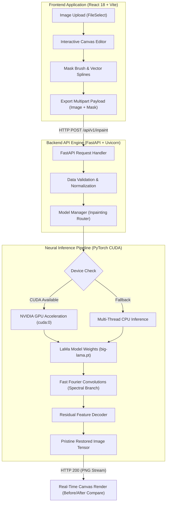
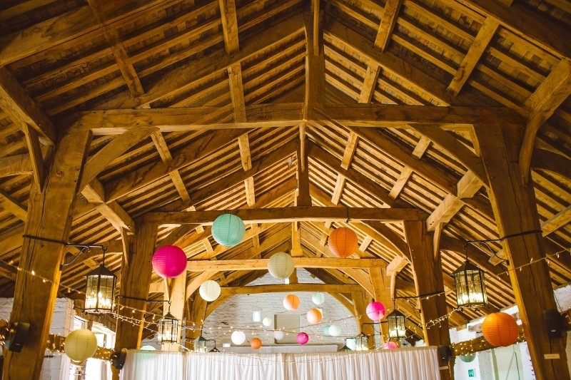
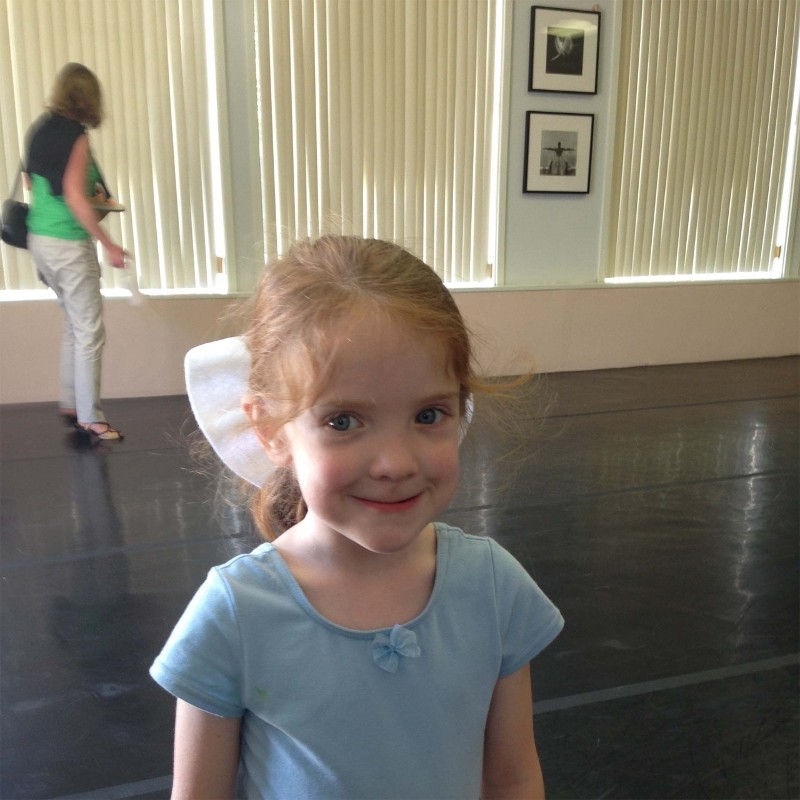
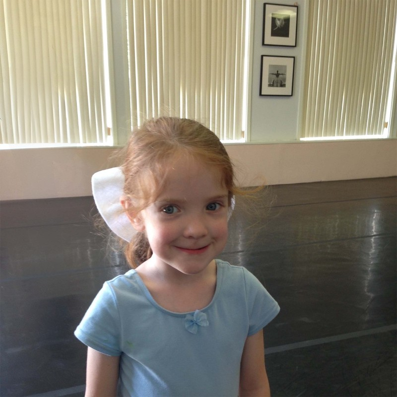
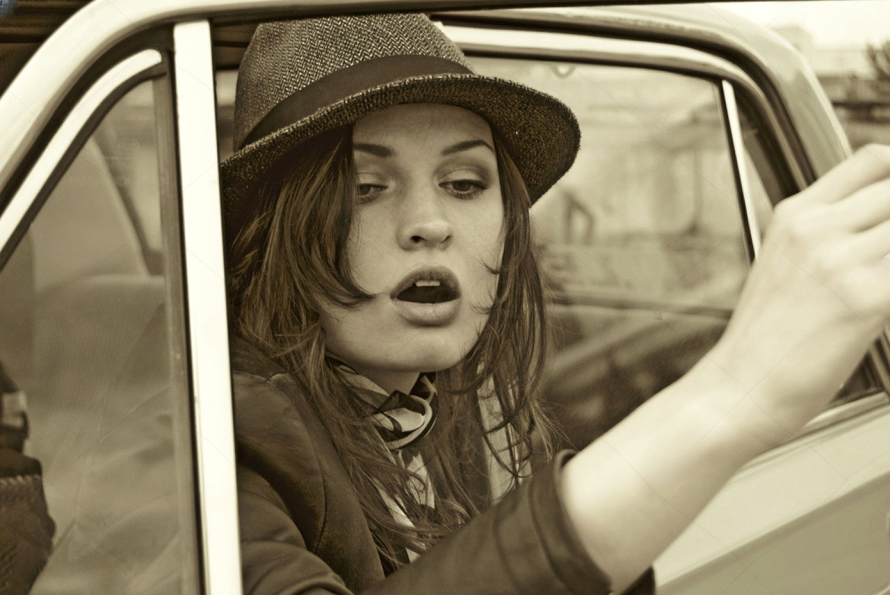
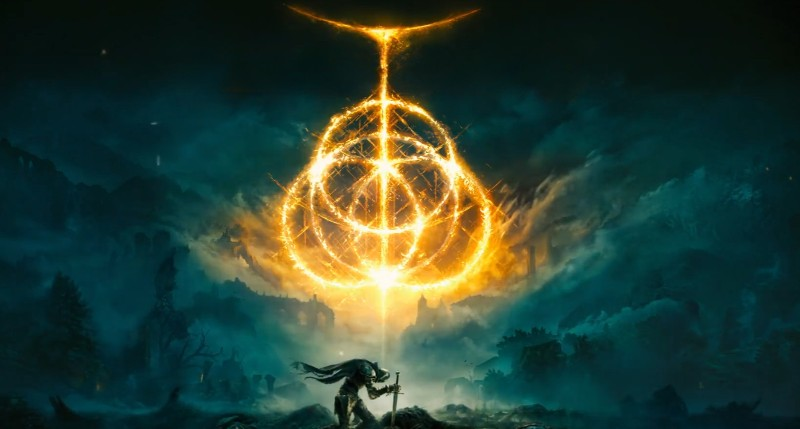

<div align="center">


# PixelRevive
### **AI-Driven Image Restoration & Intelligent Inpainting**
*Restore. Reconstruct. Revive.*

---

[](https://pytorch.org/)
[](https://developer.nvidia.com/cuda-toolkit)
[](https://react.dev/)
[](https://fastapi.tiangolo.com/)
[-blueviolet)](#lama-deep-learning-architecture)
[](LICENSE)

</div>

---

## 🏛️ Academic Affiliation & Engineering Team

**PixelRevive** is developed as a graduation engineering capstone project at the **University of Basrah**, embodying advanced principles in Computer Vision, Digital Image Processing (DIP), and Deep Convolutional Neural Networks.

| Detail | Specification |
| :--- | :--- |
| **Institution** | **University of Basrah** (جامعة البصرة) |
| **College** | **College of Engineering** (كلية الهندسة) |
| **Department** | **Department of Computer Engineering** (قسم هندسة الحاسوب) |
| **Academic Year** | **2026–2027** |
| **Project Category** | Artificial Intelligence / Digital Image Restoration |

### 👥 Engineering Team Members

| # | Student Name (Arabic) | Student ID | Academic Role |
| :---: | :--- | :---: | :--- |
| 1 | **حسين علي جاسب** | **28** | AI & Full-Stack Lead, System Architecture |
| 2 | **حسين علي حسن** | **29** | Computer Vision & DIP Specialist |
| 3 | **حسين إياد عبدالرزاق** | **23** | Backend Systems & PyTorch CUDA Optimization |
| 4 | **سجاد عباس نعمة** | **67** | Frontend Architecture & UI/UX Design |
| 5 | **طه قاسم جبار** | **75** | Model Verification & Systems Integration |

---

## 📖 Executive Summary

Digital image inpainting is the art and science of reconstructing missing, deteriorated, or unwanted regions within visual data in a manner that remains perceptually undetectable to human observers. While traditional techniques rely on boundary-driven partial differential equations (PDEs) or localized patch synthesis, they struggle when reconstructing large structural gaps or intricate periodic textures.

**PixelRevive** bridges theoretical Digital Image Processing with modern deep generative architectures. Built around Samsung Research's **Large Mask Inpainting (LaMa)** model powered by **Fast Fourier Convolutions (FFCs)**, PixelRevive achieves image-wide receptive field awareness from early layers. It enables seamless removal of unwanted artifacts, watermarks, wires, photo blemishes, and entire objects, synthesizing missing visual content with photographic consistency and high perceptual fidelity.

---

## ✨ Key Features

- 🧠 **LaMa Neural Inpainting Engine**: Powered by Fast Fourier Convolutions (FFC) to synthesize complex periodic structures and extensive damaged zones without blurry boundary artifacts.
- ⚡ **Hardware Accelerated Inference**: Optimized for NVIDIA GPUs via PyTorch CUDA (`cu121`), with native verification and memory efficiency tailored for hardware such as the NVIDIA GeForce GTX 1650 Ti GPU.
- 🔄 **Autonomous CPU Fallback**: Automatically senses hardware capabilities and defaults to multi-threaded CPU inference when dedicated GPU resources are unavailable.
- 🎨 **Redesigned Academic Studio**: Custom dark interface with a signature burgundy and warm sand palette, responsive canvas controls, dynamic brush sizing, undo/redo stacks, and interactive before/after comparisons.
- 🖱️ **One-Click Startup Automation**: Includes `RUN_PIXELREVIVE.bat` to configure isolated environments, map portable directory caches, activate GPU acceleration, and open the web portal automatically.
- 🔒 **100% Local & Privacy-Preserving**: All image transformations and neural inferences execute locally on-device without telemetry or cloud dependencies.

---

## 🔬 Digital Image Processing Concepts & Theoretical Background

### 1. The Inpainting Problem Formulation

In mathematical image processing, an observed degraded image $I_{obs}(x, y)$ defined on spatial domain $\Omega \subset \mathbb{R}^2$ is modeled as:

$$I_{obs}(x, y) = (1 - M(x, y)) \odot I_{true}(x, y) + M(x, y) \odot \eta(x, y)$$

where:
- $I_{true}(x, y)$ denotes the original uncorrupted ground-truth image.
- $M(x, y) \in \{0, 1\}$ is a binary spatial damage mask where $M(x, y) = 1$ designates pixels slated for erasure/reconstruction, and $M(x, y) = 0$ designates intact context.
- $\odot$ denotes the element-wise Hadamard product.
- $\eta(x, y)$ represents corrupted values, occlusions, or noise.

The objective of **PixelRevive** is to construct an estimation mapping $\hat{I} = f_\theta(I_{obs}, M)$ such that $\hat{I}(x, y) \approx I_{true}(x, y)$ across both spatial luminance and semantic structures.

### 2. Traditional DIP vs. Deep Fourier Inpainting

| Property | Traditional PDE (e.g., Navier-Stokes, Telea) | Patch-Based (e.g., PatchMatch) | Deep FFC Inpainting (**PixelRevive / LaMa**) |
| :--- | :--- | :--- | :--- |
| **Receptive Field** | Local neighborhood ($\Delta x < 5\text{px}$) | Regional patch dictionary search | **Global image-wide receptive field** |
| **Mask Size** | Thin scratches, small cracks ($< 5\%$ area) | Medium patches with repetitive textures | **Large arbitrary masks ($> 50\%$ area)** |
| **Semantic Hallucination**| Incapable (only diffuses gradients) | Limited to existing image patches | **High-level structural & textural synthesis** |
| **Frequency Handling** | Blurs high-frequency components | Duplicates noise | **Preserves high-frequency spectra via 2D FFT** |

### 3. Fast Fourier Convolutions (FFCs)

Standard deep convolutional layers utilize small spatial kernels (e.g., $3 \times 3$), requiring deep networks before neurons capture global scene context. LaMa bypasses this limitation using **Fast Fourier Convolutions (FFCs)**, which partition feature channels into spatial and spectral branches:

```
Input Feature Map X
       │
       ├───► [Spatial Branch] ──► Standard 2D Convolution ────────────┐
       │                                                              ▼
       └───► [Spectral Branch] ─► 2D Real FFT (F) ─► Complex Conv ─► Inverse FFT (F⁻¹) ──► Feature Fusion
```

In the spectral branch:
1. Spatial features $x \in \mathbb{R}^{H \times W}$ are transformed into the frequency domain via 2D Real Fast Fourier Transform:
   $$\mathcal{F}(x)(u, v) = \sum_{m=0}^{H-1} \sum_{n=0}^{W-1} x(m, n) e^{-j 2\pi \left(\frac{um}{H} + \frac{vn}{W}\right)}$$
2. In frequency space, a complex $1 \times 1$ convolution modulates global spectral components, providing an effective receptive field spanning the **entire image** in the first layers.
3. The inverse 2D FFT ($\mathcal{F}^{-1}$) projects features back to the spatial domain, allowing the generator to reconstruct global symmetries, repeated patterns, and sharp edges seamlessly.

---

## 🏛️ System Architecture



---

## 🖼️ Restoration Demonstrations

The following before/after examples demonstrate the inpainting capabilities of PixelRevive across various real-world degradation scenarios:

| Category | Input (Corrupted / With Object) | Restored Output (PixelRevive) |
| :---: | :---: | :---: |
| **Object Removal** |  |  |
| **Distraction Erasure** |  |  |
| **Historical Photo Restoration** |  |  |
| **Watermark & Logo Erasure** |  |  |
| **Text & Subtitle Removal** |  |  |

---

## 🛠️ Technology Stack

| Layer | Technologies | Purpose |
| :--- | :--- | :--- |
| **Frontend Framework** | React 18, TypeScript, Vite | High-performance reactive user interface |
| **Design System** | Tailwind CSS, Lucide Icons, Radix UI | Dark obsidian theme with burgundy & beige accents |
| **Backend Framework** | Python 3.12, FastAPI, Uvicorn | Asynchronous RESTful API with streaming responses |
| **Deep Learning** | PyTorch 2.5.1, Torchvision 0.20.1 | Neural network execution and tensor operations |
| **Acceleration** | NVIDIA CUDA 12.1 | Hardware acceleration for GTX 1650 Ti GPU |
| **Computer Vision** | OpenCV (`opencv-python`), Pillow, NumPy | Spatial transformation, mask dilation, and format encoding |
| **AI Architecture** | LaMa (`big-lama.pt`, 196 MB) | Fourier-based large-mask generative inpainting |

---

## 🚀 Quick Start Guide (Windows)

### Option A: One-Click Startup (Recommended)

PixelRevive includes a configured launcher that manages isolated environment execution, sets portable cache paths, verifies GPU compatibility, and starts the local web server:

1. Double-click **`RUN_PIXELREVIVE.bat`** in the project directory.
2. The launcher will automatically:
   - Configure portable scratch storage on Drive `X:` to protect system drive `C:`.
   - Activate the isolated virtual environment (`venv`).
   - Confirm PyTorch CUDA acceleration on your NVIDIA GPU.
   - Launch the server at `http://127.0.0.1:8080`.
   - Open your default web browser to the PixelRevive studio.

---

### Option B: Manual Setup from Source

#### 1. System Requirements
- **Operating System**: Windows 10/11 (64-bit) or Linux (Ubuntu 20.04+)
- **Python**: Python 3.10 to 3.12 (Isolated virtual environment strongly advised)
- **Node.js**: v18+ and npm (Required only for building frontend from source)
- **GPU (Optional but recommended)**: NVIDIA GPU with CUDA 11.8+ or 12.1+ support (e.g., GTX 1650 or higher)

#### 2. Environment Setup
```powershell
# Clone the repository
git clone https://github.com/xdc7-css/PixelRevive-AI-Inpainting.git
cd PixelRevive-AI-Inpainting

# Create isolated Python virtual environment
python -m venv venv

# Activate virtual environment
.\venv\Scripts\Activate.ps1
```

#### 3. Install PyTorch with CUDA Support
```powershell
pip install torch==2.5.1+cu121 torchvision==0.20.1+cu121 --extra-index-url https://download.pytorch.org/whl/cu121
```

#### 4. Install Dependencies
```powershell
pip install -r requirements.txt
pip install diffusers==0.27.2 transformers==4.40.2 accelerate==1.15.0 einops timm
```

#### 5. Verify CUDA GPU Recognition
```powershell
python -c "import torch; print('CUDA Available:', torch.cuda.is_available(), '| GPU:', torch.cuda.get_device_name(0) if torch.cuda.is_available() else 'None')"
```

#### 6. Launch Application
```powershell
iopaint start --model=lama --device=cuda --host=127.0.0.1 --port=8080 --model-dir="X:\models" --inbrowser
```

---

## 📂 Project Structure

```
PixelRevive-AI-Inpainting/
├── assets/                       # Demo assets, comparisons & brand vectors
│   ├── pixelrevive_logo.svg      # Primary vector emblem
│   ├── unwant_object.jpg         # Sample benchmark input
│   ├── unwant_object_clean.jpg   # Sample benchmark output
│   └── ...
├── iopaint/                      # Core Python backend engine
│   ├── model/                    # Model abstractions & Fourier inpainting logic
│   ├── plugins/                  # Interactive segmentation & utility plugins
│   ├── api.py                    # FastAPI route definitions
│   └── web_app/                  # Compiled production frontend build
├── web_app/                      # React 18 + Vite source codebase
│   ├── public/                   # Favicons & public static manifests
│   ├── src/
│   │   ├── components/           # UI components (Header, Editor, About, FileSelect)
│   │   ├── hooks/                # Canvas & image manipulation hooks
│   │   ├── lib/                  # State management (Zustand) & API connectors
│   │   └── globals.css           # Custom dark theme with burgundy/beige tokens
│   ├── package.json              # Frontend package definitions
│   └── vite.config.ts            # Vite compiler configuration
├── RUN_PIXELREVIVE.bat           # One-click portable Windows launcher
├── requirements.txt              # Production Python dependencies
├── .gitignore                    # Secure git exclusions
├── LICENSE                       # Apache License 2.0
└── README.md                     # Comprehensive academic documentation
```

---

## 🔧 Troubleshooting & Technical Tips

> [!TIP]
> **GPU Memory Optimization**: The LaMa architecture is exceptionally lightweight (~196 MB parameters) and comfortably fits within 4 GB of VRAM on NVIDIA GTX 1650 GPUs. If processing ultra-high resolution images (> 4K), consider resizing the canvas or utilizing tile cropping in settings.

> [!NOTE]
> **Isolated Storage on Secondary Drives**: To prevent depleting space on system drive `C:`, PixelRevive configures environment variables (`TEMP`, `TORCH_HOME`, `HF_HOME`, `XDG_CACHE_HOME`) to reside on secondary drives (`X:\`).

> [!IMPORTANT]
> **Model Download Integrity**: The primary LaMa checkpoint `big-lama.pt` has an expected MD5 checksum of `E3AA4AAA15225A33EC84F9F4BC47E500`. The system will automatically download this file on first execution if not pre-cached in `X:\models`.

---

## 📜 Attribution & License

- **PixelRevive** is customized, redesigned, and maintained by the Computer Engineering graduation team at the **University of Basrah** (2026–2027).
- Core inpainting pipeline architecture is built upon the open-source **IOPaint** project by **Sanster**, released under the **Apache License 2.0**.
- The **LaMa (Large Mask Inpainting)** model architecture is developed and open-sourced by **Samsung Research** under the Apache License 2.0.

Licensed under the [Apache License, Version 2.0](LICENSE).
