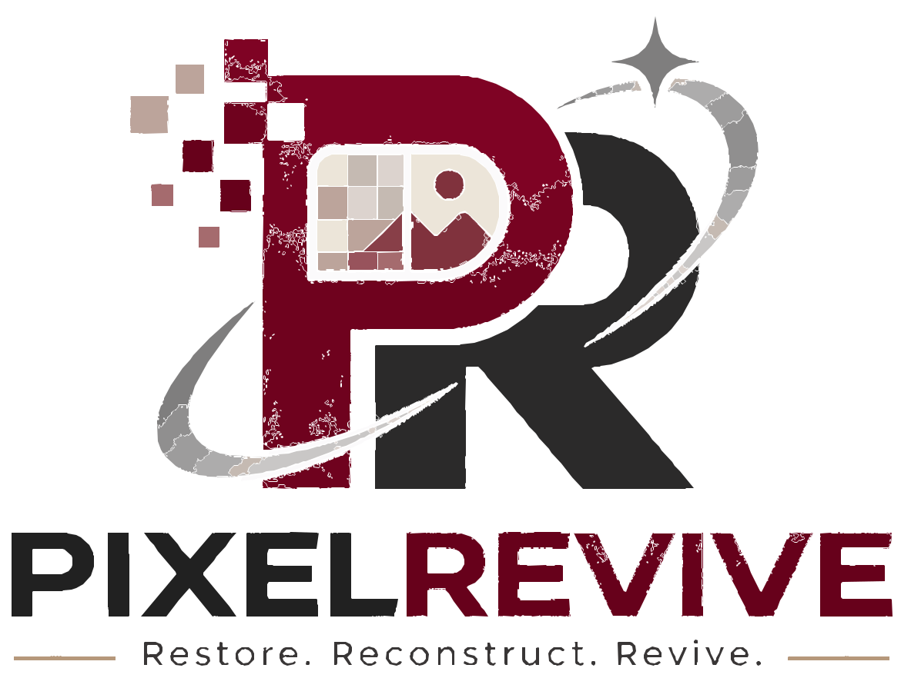
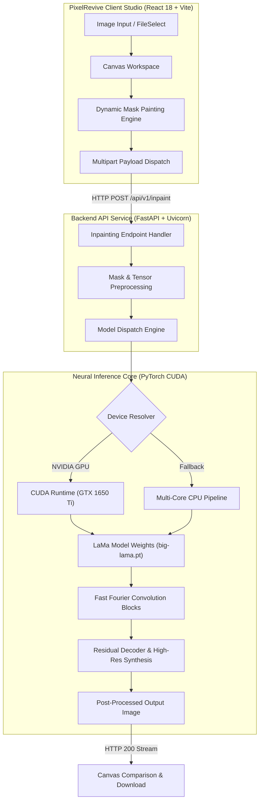
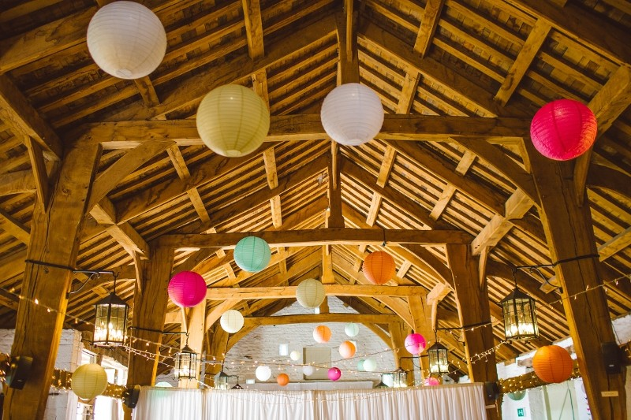
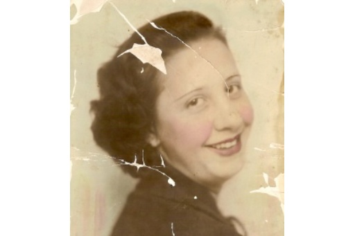
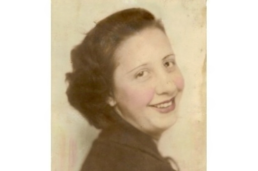
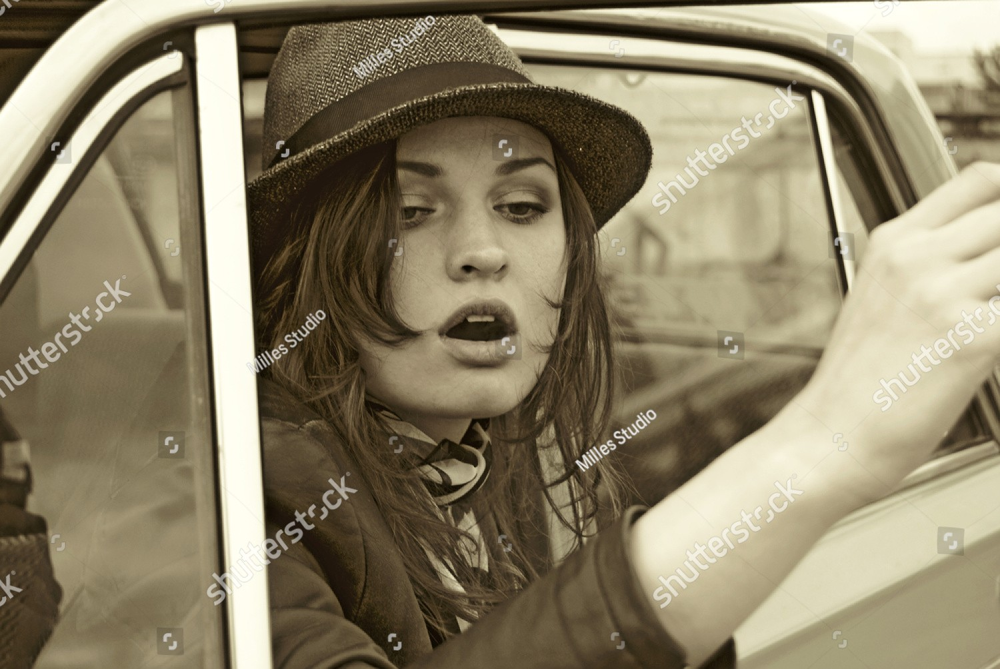
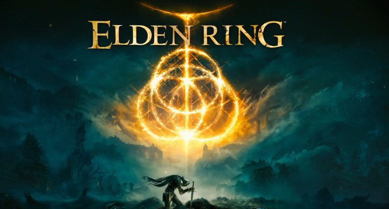

<div align="center">



# PixelRevive
### **AI-Driven Image Restoration & Intelligent Inpainting**
*Restore. Reconstruct. Revive.*

---

[](https://uobasrah.edu.iq/)
[-8B263E?style=flat)](https://uobasrah.edu.iq/)
[](https://pytorch.org/)
[](https://developer.nvidia.com/cuda-toolkit)
[](https://react.dev/)
[](https://fastapi.tiangolo.com/)
[](LICENSE)

</div>

---

## 🏛️ Academic Identity & Capstone Engineering Team

**PixelRevive** is an engineering graduation capstone project developed at the **University of Basrah**, demonstrating the fusion of Digital Image Processing (DIP) mathematics, frequency-domain spatial transformations, and Deep Convolutional Neural Networks for semantic image restoration.

| Academic Profile | Details |
| :--- | :--- |
| **Institution** | **University of Basrah** (جامعة البصرة) |
| **College** | **College of Engineering** (كلية الهندسة) |
| **Department** | **Department of Computer Engineering** (قسم هندسة الحاسوب) |
| **Academic Year** | **2026–2027** |
| **Project Focus** | Computer Vision, Digital Image Processing, Deep Learning Inpainting |

### 👥 Engineering Team

| # | Student Name (Arabic) | Student ID | Engineering Specialization & Role |
| :---: | :--- | :---: | :--- |
| 1 | **حسين علي جاسب** | **28** | AI Pipeline Lead, Full-Stack Architecture |
| 2 | **حسين علي حسن** | **29** | Computer Vision & Image Processing Algorithms |
| 3 | **حسين إياد عبدالرزاق** | **23** | Backend Architecture & PyTorch CUDA Optimization |
| 4 | **سجاد عباس نعمة** | **67** | Frontend Architecture, UI/UX Design System |
| 5 | **طه قاسم جبار** | **75** | Model Integration, Hardware Verification & Testing |

---

## 📖 Project Overview

Digital image inpainting addresses the ill-posed mathematical challenge of reconstructing corrupted, obscured, or intentionally removed visual regions such that the restored image appears natural and contiguous.

While classical image processing methods (e.g., partial differential equations, exemplar-based patch replication) function adequately for small local textures or narrow scratches, they falter when challenged with extensive masks or structural patterns that demand semantic scene understanding.

**PixelRevive** solves this challenge by deploying deep generative architectures equipped with **Fast Fourier Convolutions (FFCs)**. Unlike standard convolutional neural networks whose receptive fields grow slowly layer by layer, PixelRevive's spectral branch captures global scene context from initial network layers. This enables:
- Seamless erasure of foreground obstacles, pedestrians, text, and watermarks.
- Faithful restoration of old, scratched, or deteriorated photography.
- High-fidelity texture and edge reconstruction without boundary blur.

---

## ✨ System Features

- 🧠 **Fourier-Domain Deep Inpainting**: Employs Large Mask Inpainting (LaMa) with Fast Fourier Convolutions to resolve both global structure and high-frequency local textures.
- ⚡ **Dedicated CUDA Hardware Acceleration**: Optimized for NVIDIA GPUs (specifically verified on the NVIDIA GeForce GTX 1650 Ti GPU) to ensure near-instantaneous inference.
- 🔄 **Autonomous CPU Fallback**: Automatically senses hardware capabilities and provides smooth multi-threaded CPU inference if an NVIDIA GPU is not detected.
- 🎨 **PixelRevive Studio Workspace**: A bespoke dark-mode interface with deep burgundy and muted beige tones, responsive canvas controls, dynamic brush sizing, mask overlays, undo/redo stacks, and before/after inspection.
- 🖱️ **Portable One-Click Launcher**: Includes `RUN_PIXELREVIVE.bat` to automate environment activation, portable cache allocation, device detection, and browser launching.
- 🔒 **100% On-Device Privacy**: Operates entirely offline with zero cloud telemetry; user images and weights remain strictly on the local workstation.

---

## 🔬 Digital Image Processing Concepts & Mathematical Formulation

### 1. Inpainting Problem Modeling

Mathematically, given an input observed image $I_{obs}: \Omega \to \mathbb{R}^C$ defined over spatial domain $\Omega \subset \mathbb{R}^2$ with $C$ color channels, the corruption process is modeled as:

$$I_{obs}(x, y) = (1 - M(x, y)) \odot I_{true}(x, y) + M(x, y) \odot \eta(x, y)$$

Where:
- $I_{true}(x, y)$ represents the pristine original image data.
- $M(x, y) \in \{0, 1\}$ denotes the binary spatial mask ($M=1$ specifies corrupted/masked pixels; $M=0$ specifies uncorrupted context).
- $\odot$ represents the Hadamard (element-wise) product.
- $\eta(x, y)$ represents noise, occluding text, or unwanted artifacts.

**PixelRevive** learns a parametric mapping function $f_\theta$ parametrized by weights $\theta$ that generates a reconstructed image:

$$\hat{I} = f_\theta(I_{obs}, M)$$

such that the reconstruction satisfies both local spatial consistency:

$$\mathcal{L}_{local} = \| (1 - M) \odot (\hat{I} - I_{true}) \|_1$$

and deep perceptual / adversarial fidelity within the masked domain $\Omega_M = \{(x, y) \mid M(x, y) = 1\}$.

---

### 2. Traditional DIP vs. Deep Fourier Inpainting

| Dimension | Classical PDE Inpainting (Telea, Navier-Stokes) | Patch-Based Synthesis (PatchMatch) | Spectral Deep Learning (**PixelRevive**) |
| :--- | :--- | :--- | :--- |
| **Effective Receptive Field** | Strictly local boundary ($\sim 3-5$ pixels) | Search neighborhood within same image | **Image-wide global receptive field** |
| **Reconstruction Mechanism** | Propagates gradients along isophotes | Copies and blends nearest spatial patches | **Generates semantic content via learned weights** |
| **Handling Large Masks** | Blurs towards the average color | Creates repetitive tiling artifacts | **Reconstructs natural structures and textures** |
| **Frequency Handling** | Attenuates high frequencies (blur) | Duplicates high-frequency noise | **Operates directly in the frequency domain via 2D FFT** |

---

### 3. Fast Fourier Convolutions (FFC) Architecture

Standard Convolutional Neural Networks rely on small localized receptive fields ($3 \times 3$ kernels), which struggle to aggregate information across distant pixels without numerous pooling layers that destroy fine resolution.

PixelRevive utilizes **Fast Fourier Convolutions (FFCs)**, which split feature maps into two concurrent pathways:

```
                      ┌────────────────────────────────────────────────────────┐
                      │                 Input Feature Tensor X                 │
                      └───────────────────────────┬────────────────────────────┘
                                                  │
                         ┌────────────────────────┴────────────────────────┐
                         ▼                                                 ▼
               [ Spatial Branch ]                                 [ Spectral Branch ]
           Standard Local Convolutions                       Global Frequency Synthesis
                         │                                                 │
                         │                                    2D Real Fast Fourier Transform
                         │                                           F(u, v) = RFFT(x)
                         │                                                 │
                         │                                     Complex-Valued Convolution
                         │                                           G(u, v) = W * F
                         │                                                 │
                         │                                      Inverse Real 2D FFT
                         │                                           y = IRFFT(G)
                         │                                                 │
                         └────────────────────────┬────────────────────────┘
                                                  ▼
                                      [ Channel Concat & Fusion ]
                                                  ▼
                                     Output Reconstructed Features
```

The 2D Real Discrete Fourier Transform transforms spatial feature map $x(m, n)$ of dimensions $H \times W$ into spatial frequency components:

$$\mathcal{F}\{x\}(u, v) = \sum_{m=0}^{H-1} \sum_{n=0}^{W-1} x(m, n) e^{-j 2\pi \left( \frac{um}{H} + \frac{vn}{W} \right)}$$

Because each frequency coefficient $(u, v)$ depends on every spatial pixel $(m, n)$, convolution in the frequency domain allows the network to incorporate global scene context in a single layer. The Inverse FFT ($\mathcal{F}^{-1}$) reconstructs spatial features with high-frequency details preserved.

---

## 🏛️ System Architecture



---

## 🖼️ Restoration Results

| Degradation Category | Input Corrupted Image | PixelRevive Restored Output |
| :---: | :---: | :---: |
| **Object Removal** |  |  |
| **Pedestrian Erasure** |  |  |
| **Old Photo Restoration** |  |  |
| **Watermark & Logo Removal**|  |  |
| **Text Erasure** |  |  |

---

## 🛠️ Technology Stack

| Layer | Component | Description |
| :--- | :--- | :--- |
| **Application UI** | React 18, Vite, TypeScript | Modern reactive client architecture |
| **Design System** | Tailwind CSS, Radix UI, Lucide | Dark obsidian theme with burgundy & beige accents |
| **API Server** | FastAPI, Uvicorn, Python 3.12 | High-concurrency asynchronous inference server |
| **Deep Learning** | PyTorch 2.5.1, Torchvision 0.20.1 | Tensor operations and deep model orchestration |
| **Acceleration** | NVIDIA CUDA 12.1 | Hardware acceleration for NVIDIA GPUs |
| **Image Processing** | OpenCV, NumPy, Pillow | Spatial transformations, mask dilation, format conversion |
| **Neural Backbone**| LaMa (`big-lama.pt`, ~196 MB) | Fast Fourier Convolution generative architecture |

---

## 🚀 Installation & Running Guide

### Method 1: Windows One-Click Launcher (Recommended)

1. Double-click **`RUN_PIXELREVIVE.bat`** in the project directory.
2. The batch launcher automatically:
   - Configures portable cache and scratch paths on Drive `X:` to protect system drive `C:`.
   - Activates the local virtual environment (`venv`).
   - Verifies NVIDIA CUDA GPU acceleration.
   - Starts the server and opens `http://127.0.0.1:8080` in your default browser.

---

### Method 2: Manual Installation from Source

#### Prerequisites
- **OS**: Windows 10/11 (64-bit) or Linux (Ubuntu 20.04+)
- **Python**: Python 3.10 – 3.12
- **Node.js**: v18+ and npm (only needed when rebuilding the frontend from source)
- **GPU**: NVIDIA GPU with CUDA 11.8+ or 12.1+ (e.g. GTX 1650 or higher)

#### 1. Clone the Repository
```powershell
git clone https://github.com/xdc7-css/PixelRevive-AI-Inpainting.git
cd PixelRevive-AI-Inpainting
```

#### 2. Create and Activate Virtual Environment
```powershell
python -m venv venv
.\venv\Scripts\Activate.ps1
```

#### 3. Install PyTorch with CUDA Support
```powershell
pip install torch==2.5.1+cu121 torchvision==0.20.1+cu121 --extra-index-url https://download.pytorch.org/whl/cu121
```

#### 4. Install Dependencies
```powershell
pip install -r requirements.txt
pip install diffusers==0.27.2 transformers==4.40.2 accelerate==1.15.0 einops timm
```

#### 5. Verify Hardware Acceleration
```powershell
python -c "import torch; print('CUDA Available:', torch.cuda.is_available(), '| Device:', torch.cuda.get_device_name(0) if torch.cuda.is_available() else 'CPU')"
```

#### 6. Run PixelRevive
```powershell
iopaint start --model=lama --device=cuda --host=127.0.0.1 --port=8080 --model-dir="X:\models" --inbrowser
```

---

## 📂 Project Structure

```
PixelRevive-AI-Inpainting/
├── assets/                       # Demonstration assets and PixelRevive brand SVG
│   ├── pixelrevive_logo.svg      # Official vector emblem
│   ├── unwant_object.jpg         # Corrupted input benchmark
│   ├── unwant_object_clean.jpg   # Restored output benchmark
│   └── ...
├── iopaint/                      # Core backend engine & model router
│   ├── model/                    # LaMa neural definitions & Fourier transforms
│   ├── api.py                    # RESTful FastAPI endpoints
│   └── web_app/                  # Compiled production client build
├── web_app/                      # PixelRevive React 18 + Vite source
│   ├── public/                   # Favicons and web manifests
│   ├── src/
│   │   ├── components/           # UI studio components (Header, Editor, About, FileSelect)
│   │   ├── hooks/                # Canvas, brush & interaction hooks
│   │   └── globals.css           # Styling with burgundy and beige tokens
│   ├── package.json              # Client package specifications
│   └── vite.config.ts            # Vite compiler configuration
├── scripts/                      # Utility and test scripts
│   └── test_inpaint.py           # Automated CUDA inpainting test verification
├── RUN_PIXELREVIVE.bat           # Portable one-click Windows launcher
├── requirements.txt              # Python dependency manifest
├── .gitignore                    # Git tracking rules
├── LICENSE                       # Apache License 2.0
└── README.md                     # Academic project documentation
```

---

## ⚖️ License & Open-Source Acknowledgments

- **PixelRevive** is released under the **Apache License, Version 2.0**. See the [LICENSE](LICENSE) file for complete details.
- **Academic Context**: Developed as a computer engineering capstone project at the **University of Basrah** (2026–2027).
- **Foundational Architecture**: Built utilizing open-source machine learning and computer vision frameworks, incorporating the **Large Mask Inpainting (LaMa)** architecture developed by Samsung Research. All foundational third-party open-source contributions are gratefully acknowledged.
